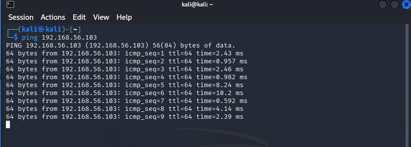
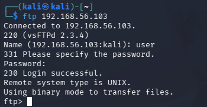

# Desafio DIO - Ataque Brute Force com Medusa e Kali Linux

## Descrição

Projeto desenvolvido durante o curso da DIO em parceria com o Santander com o objetivo de estudar ataques de força bruta e medidas de mitigação utilizando Kali Linux, Medusa e ambientes vulneráveis.

## Ambiente

- Windows 11
- VirtualBox
- Kali Linux
- Metasploitable 2
- Medusa
- Nmap

## Objetivos

- Compreender ataques de força bruta
- Utilizar o Medusa para auditoria de segurança
- Realizar enumeração de serviços com Nmap
- Documentar os resultados obtidos
- Aplicar recomendações de mitigação

## Estrutura do Projeto

```text
images/
wordlists/
README.md
```

## Status

Laboratório em construção.

## Teste de Conectividade

Foi realizado um teste de conectividade entre o Kali Linux e o Metasploitable 2.

Comando utilizado:

```bash
ping 192.168.56.103
```

Resultado:

A comunicação foi estabelecida com sucesso entre as duas máquinas.

### Evidência



### Análise

O teste de conectividade foi bem-sucedido, confirmando a comunicação entre as máquinas Kali Linux e Metasploitable 2 através da rede Host-Only configurada no VirtualBox. Essa etapa valida a conectividade necessária para a execução dos testes de auditoria e segurança previstos no laboratório.

---

## Enumeração de Serviços


Foi realizado um escaneamento de serviços utilizando o Nmap.

Comando utilizado:

```bash
nmap -sV 192.168.56.103
```

Serviços encontrados:

- FTP
- SSH
- Telnet
- HTTP
- SMB
- MySQL
- PostgreSQL
- Apache Tomcat

### Evidência



### Análise

O escaneamento realizado com o Nmap identificou diversos serviços ativos na máquina Metasploitable 2. Entre eles destacam-se FTP, SSH, Telnet, HTTP, SMB e bancos de dados, representando múltiplas superfícies de ataque para estudo em ambiente controlado.

---

---

## Validação Manual do Serviço FTP

Foi realizada uma conexão manual ao serviço FTP identificado durante a fase de enumeração com o objetivo de validar o acesso antes da execução de testes automatizados.

### Comando utilizado

```bash
ftp 192.168.56.103
```

### Credenciais utilizadas

```text
Usuário: user
Senha: user
```

### Resultado

A autenticação foi realizada com sucesso no serviço FTP.

### Evidência


### Análise

O serviço FTP permitiu autenticação utilizando credenciais simples e previsíveis. Esse comportamento representa um risco de segurança, pois aumenta a probabilidade de sucesso de ataques de força bruta e de adivinhação de senhas.
---

---

## Próxima Etapa: Teste de Força Bruta com Medusa

