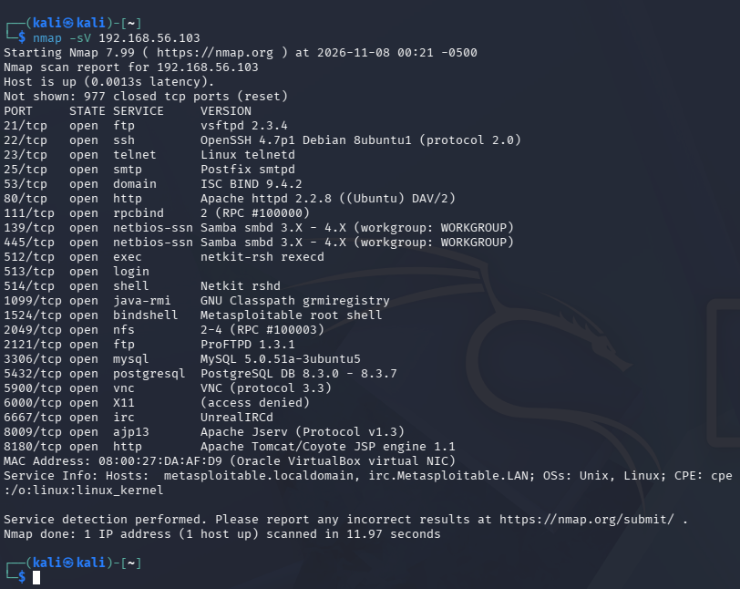

# Desafio DIO - Ataque Brute Force com Medusa e Kali Linux

## Descrição

Projeto desenvolvido durante o curso da DIO em parceria com o Santander com o objetivo de estudar ataques de força bruta e medidas de mitigação utilizando Kali Linux, Medusa e ambientes vulneráveis.

## Ambiente

- Windows 11
- VirtualBox
- Kali Linux
- Metasploitable 2
- Medusa
- Nmap

## Objetivos

- Compreender ataques de força bruta
- Utilizar o Medusa para auditoria de segurança
- Realizar enumeração de serviços com Nmap
- Documentar os resultados obtidos
- Aplicar recomendações de mitigação

## Estrutura do Projeto

```text
images/
wordlists/
README.md
```

## Status

Laboratório em construção.

## Teste de Conectividade

Foi realizado um teste de conectividade entre o Kali Linux e o Metasploitable 2.

Comando utilizado:

```bash
ping 192.168.56.103
```

Resultado:

A comunicação foi estabelecida com sucesso entre as duas máquinas.

### Evidência


### Análise

O teste de conectividade confirmou que as máquinas Kali Linux e Metasploitable 2 estão na mesma rede Host-Only configurada no VirtualBox, permitindo a realização dos testes de segurança em ambiente controlado.
---


## Enumeração de Serviços

Foi realizado um escaneamento de serviços utilizando o Nmap.

Comando utilizado:

```bash
nmap -sV 192.168.56.103
```

Serviços encontrados:

- FTP
- SSH
- Telnet
- HTTP
- SMB
- MySQL
- PostgreSQL
- Apache Tomcat

### Evidência



### Análise

O escaneamento identificou diversos serviços ativos e potencialmente vulneráveis. Os serviços FTP, SSH, Telnet, HTTP, SMB e bancos de dados serão avaliados para compreender riscos relacionados a credenciais fracas e configurações inseguras.

